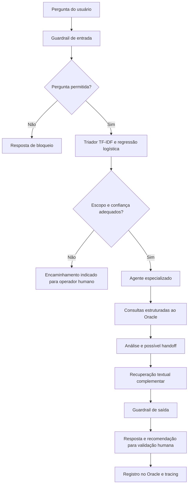
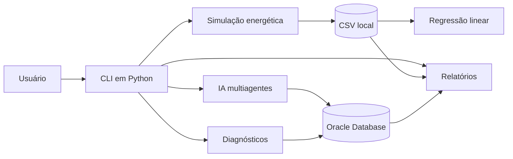

<div align="center">


### Inteligência artificial, simulação energética e análise de dados para uma colônia sustentável em Marte


**[Visão geral](#visão-geral) · [Funcionalidades](#funcionalidades) · [Arquitetura](#arquitetura) · [Instalação](#instalação-e-execução) · [Inteligência artificial](#inteligência-artificial) · [Testes](#testes)**

</div>

---

## Visão geral

O **SIFSM Aurora Siger** (*Sistema Integrado de Futuro Sustentável em Marte*) é uma aplicação acadêmica em Python que reúne **simulação de geração e consumo de energia**, **monitoramento de uma bateria virtual**, **análises estatísticas**, **relatórios** e **inteligência artificial baseada em agentes especializados**.

O sistema representa uma instalação sustentável em Marte e permite investigar como a disponibilidade de energia solar, as oscilações de consumo e períodos de baixa geração afetam a autonomia energética. O objetivo é transformar dados simulados em indicadores, alertas e recomendações úteis para apoiar decisões humanas.

> **Contexto da simulação:** os dados representam um cenário didático e sintético, não medições de uma instalação real em Marte. A IA utiliza registros do Oracle, enquanto a simulação local gera e consulta dados em CSV; esses fluxos não realizam sincronização automática.

### O que o sistema oferece

| Módulo | Recursos |
|:--|:--|
| **Simulação energética** | Geração solar, consumo, carga e descarga, perdas, excedente, déficit e alertas por intervalo |
| **Análise de dados** | Consulta de registros, regressão linear e métricas de avaliação |
| **Inteligência artificial** | Triagem de perguntas, agentes de energia/ambiente/dados, contexto da sessão e recomendações |
| **Banco Oracle** | Consultas estruturadas de simulações, medições e resultados; registro de respostas da IA |
| **Relatórios** | Resumo energético, alertas, histórico Oracle e exportação de resultados diários |
| **Diagnósticos** | Verificação de conexão, ambiente, dependências e integridade dos módulos |

---

## Funcionalidades

### 1. Simulação de energia e armazenamento

A simulação padrão percorre **168 intervalos de uma hora**, correspondentes a **sete dias**. Para cada intervalo, registra a geração fotovoltaica estimada, a demanda energética e a interação com uma bateria virtual.

- **Energia solar:** perfil de geração diurna com variações sintéticas.
- **Consumo:** demanda base, aumento durante o dia e pequenas oscilações.
- **Condições adversas:** queda da geração solar durante tempestades simuladas nos dias 4 e 5.
- **Armazenamento:** capacidade de 300 kWh, carga inicial de 240 kWh e eficiência de 95% nos processos de carga e descarga.
- **Balanço energético:** cálculo do uso da bateria, perdas, excedentes e demanda não atendida.
- **Alertas:** sinalização quando a bateria fica abaixo de 20% da capacidade ou existe déficit energético.
- **Exportação:** gravação dos registros em `dados_aurora_siger.csv`.

A semente aleatória fixa permite reproduzir os mesmos resultados ao repetir a simulação com os mesmos parâmetros.

### 2. Regressão linear e indicadores

O módulo estatístico avalia uma relação linear entre a **hora da simulação** e o **consumo energético médio**. Ele divide os registros em 80% para treinamento e 20% para teste temporal, retornando:

- Coeficiente angular e intercepto da reta;
- Erro absoluto médio (**MAE**);
- Raiz do erro quadrático médio (**RMSE**);
- Coeficiente de determinação (**R²**), quando definido;
- Comparação do MAE com uma referência baseada na média do treinamento;
- Estimativa ilustrativa do consumo para a hora seguinte.

A regressão é um recurso de **análise matemática e demonstração estatística**, não uma previsão operacional garantida.

### 3. Relatórios operacionais

O menu de relatórios reúne quatro operações:

| Opção | Resultado |
|:--|:--|
| Resumo energético | Total de geração, consumo, saldo, déficit, alertas e carga final da bateria |
| Histórico Oracle | Consulta das dez simulações mais recentes cadastradas no banco |
| Exportação diária | Cria `relatorios/resumo_energetico_por_dia.csv` com métricas agregadas por dia |
| Alertas de sustentabilidade | Quantidade de intervalos em alerta e déficit acumulado por dia |

Os relatórios baseados no CSV usam os dados da simulação local. A consulta de histórico utiliza o Oracle.

### 4. Diagnósticos e configurações

O sistema permite conferir a conexão com o Oracle, visualizar dados do ambiente Python, identificar bibliotecas disponíveis e verificar os arquivos essenciais do projeto. As credenciais de acesso ao banco não são exibidas nos diagnósticos.

---

## Inteligência artificial

O SIFSM utiliza uma **arquitetura multiagentes orientada a tarefas**. Em vez de produzir respostas abertas sobre qualquer assunto, o fluxo classifica a intenção da pergunta e encaminha a consulta a uma área especializada.

| Componente | Responsabilidade |
|:--|:--|
| **Triador** | Classificar a pergunta por área usando TF-IDF e regressão logística |
| **Agente de energia** | Analisar geração, consumo, saldo e possíveis déficits |
| **Agente ambiental** | Examinar irradiância, temperatura e dias com menor disponibilidade solar |
| **Agente de dados** | Consultar metadados da simulação e resultados de regressão armazenados no Oracle |
| **Base textual** | Recuperar trechos de documentos de exemplo por similaridade de texto |
| **Guardrails** | Bloquear solicitações inseguras, proteger temas sensíveis e limitar a atuação do sistema |
| **Tracing** | Registrar etapas de triagem, roteamento e processamento durante a sessão |

### Fluxo de atendimento



O sistema usa um limiar de confiança de **60%** no triador. Perguntas fora do escopo ou abaixo desse limiar recebem uma orientação de encaminhamento humano. Os agentes podem realizar *handoff* entre si, como quando um alerta energético demanda uma explicação ambiental.

As recomendações são **orientativas**: a aplicação não executa mudanças físicas na instalação, não desliga equipamentos e não envia notificações externas efetivas. O menu inclui uma **demonstração de webhook simulado**, útil para visualizar o fluxo de geração de eventos e revisão humana.

**Exemplos de consultas:**

```text
Qual o saldo de energia da semana?
Como está a irradiância do dia 2?
Mostre os resultados da regressão.
Qual o consumo total?
Quais dias tiveram menos sol?
```

### Segurança e rastreabilidade

- Os agentes consultam o Oracle por meio de SQL predefinido, com parâmetros vinculados quando aplicável.
- Solicitações associadas a ações inseguras ou dados individuais protegidos são bloqueadas por regras explícitas.
- O histórico da conversa e os eventos de tracing são mantidos durante a sessão da aplicação.
- Respostas processadas pelo fluxo são enviadas à tabela `RECOMENDACAO_IA`; falhas de gravação são registradas no tracing.
- A base textual é composta por exemplos internos, com busca por similaridade TF-IDF; não se trata de uma integração com um serviço externo de IA generativa.

---

## Arquitetura

O projeto utiliza uma arquitetura modular, com **interface de linha de comando (CLI)**, módulos de simulação e análise, agentes inteligentes e acesso opcional ao Oracle.



> Os conjuntos CSV e Oracle constituem fontes independentes na implementação apresentada. A execução de uma simulação em CSV não insere automaticamente seus registros no banco.

### Organização do repositório

```text
SIFSM_Aurora_Siger/
├── codigo_fonte.py                  # Interface principal e menus
├── banco_aurora_siger.sql           # Estrutura e registros de exemplo do Oracle
├── dados_aurora_siger.csv           # Dados da simulação local
├── requirements.txt                 # Dependências Python
├── ia/
│   └── ia_agentes.py                # Triagem, agentes, guardrails e sessão
├── src/
│   ├── simulation.py                # Geração e exportação da simulação
│   ├── regression.py                # Regressão linear e métricas
│   ├── reports.py                   # Resumos, alertas e exportação
│   ├── system_status.py             # Diagnósticos do ambiente e Oracle
│   └── services.py                  # Funções de serviço e validação
├── relatorios/
│   └── resumo_energetico_por_dia.csv
├── tests/
│   ├── test_modulos.py              # Testes de simulação e regressão
│   └── test_simulation.py           # Testes de validação de entradas
└── docs/                             # Documentação complementar
```

### Modelo de dados Oracle

O script `banco_aurora_siger.sql` define quatro tabelas centrais:

| Tabela | Conteúdo |
|:--|:--|
| `SIMULACAO` | Identificação, período e situação das simulações |
| `INTERVALO_HORARIO` | Geração, consumo, saldo, irradiância e temperatura por intervalo |
| `REGRESSAO_RESULTADO` | Variáveis, coeficientes e métricas estatísticas |
| `RECOMENDACAO_IA` | Respostas, explicações e recomendações associadas a simulações |

**Atenção ao banco:** o script SQL contém operações de recriação de tabelas. Execute somente em um ambiente autorizado, após verificar seu conteúdo e os dados existentes.

---

## Tecnologias

| Tecnologia | Aplicação |
|:--|:--|
| **Python** | Interface CLI, integração entre módulos e regras da aplicação |
| **NumPy** | Cálculos energéticos, geração de dados e regressão numérica |
| **pandas** | Manipulação de DataFrames, leitura, agrupamento e exportação CSV |
| **scikit-learn** | Classificador de intenções e busca textual por similaridade |
| **Oracle Database / python-oracledb** | Consultas SQL e persistência de respostas da IA |
| **unittest / pytest** | Testes de comportamento e validação |

---

## Instalação e execução

### Requisitos

- Python **3.12** (recomendado para o ambiente do projeto);
- Git;
- Terminal ou Visual Studio Code;
- Oracle Database acessível para consultas e recursos que dependem do banco.

### 1. Clonar o repositório

```bash
git clone https://github.com/lucasgesini45-coder/SIFSM_Aurora_Siger.git
cd SIFSM_Aurora_Siger
```

### 2. Preparar o ambiente Python

**Windows (PowerShell):**

```powershell
py -3.12 -m venv .venv
.\.venv\Scripts\Activate.ps1
python -m pip install -r requirements.txt
```

**Linux ou macOS:**

```bash
python3 -m venv .venv
source .venv/bin/activate
python -m pip install -r requirements.txt
```

### 3. Iniciar a aplicação

```bash
python codigo_fonte.py
```

O menu principal apresenta as seções de **gestão de dados**, **simulação e análises**, **inteligência artificial**, **relatórios** e **configurações**.

### 4. Executar a simulação

No menu principal, selecione **2 → 1** para gerar os 168 registros horários. Em seguida:

- **2 → 2:** visualizar os últimos registros do CSV;
- **2 → 3:** calcular a regressão linear;
- **4 → 1:** consultar o resumo energético;
- **4 → 3:** exportar o relatório consolidado por dia;
- **4 → 4:** consultar alertas de sustentabilidade.

Os módulos de simulação e regressão também podem ser executados diretamente:

```bash
python -m src.simulation
python -m src.regression
```

### 5. Configurar acesso ao Oracle

O acesso ao banco utiliza três variáveis de ambiente: `ORACLE_USER`, `ORACLE_PASSWORD` e `ORACLE_DSN`.

**PowerShell:**

```powershell
$env:ORACLE_USER = "seu_usuario"
$env:ORACLE_DSN = "servidor:1521/servico"
$cred = Get-Credential -UserName $env:ORACLE_USER
$env:ORACLE_PASSWORD = $cred.GetNetworkCredential().Password
python codigo_fonte.py
```

No aplicativo, use **5 → 1** para testar a conexão e **3 → 3** para consultar o status da IA e dos registros Oracle.

Não publique senhas, endereços privados ou credenciais reais no repositório.

---

## Exemplo de navegação

```text
===== SIFSM AURORA SIGER =====
1. Gestão de dados
2. Simulação e análises
3. Inteligência artificial
4. Relatórios
5. Configurações
0. Sair
Escolha uma opção: 2

===== SIMULAÇÃO E ANÁLISES =====
1. Executar simulação de 168 horas
2. Consultar resultados do CSV
3. Executar regressão linear
0. Voltar
```

O submenu de inteligência artificial oferece perguntas, análise geral, verificação de status, demonstrações, webhook simulado, histórico, tracing e explicação dos limites de segurança.

---

## Testes

Os testes automatizados verificam aspectos da simulação e da análise estatística, incluindo reprodutibilidade, conservação de energia, limites de bateria, exportação CSV, regressão sobre dados conhecidos e rejeição de entradas inválidas.

```bash
python -m unittest discover -s tests -v
```

Para executar também os testes escritos com `pytest`:

```bash
python -m pip install pytest
python -m pytest tests/ -v
```

Os testes de unidade não substituem a verificação da conectividade com o Oracle e da disponibilidade dos registros no ambiente de execução.

---

## Sustentabilidade e aplicação prática

O projeto explora a gestão de recursos críticos em um cenário espacial, com foco em quatro princípios:

1. **Eficiência energética:** acompanhar geração, demanda, perdas e excedentes para compreender o aproveitamento da energia disponível.
2. **Resiliência:** observar a autonomia da bateria e situações de déficit durante eventos de baixa produção solar.
3. **Decisão orientada a dados:** utilizar indicadores e modelos estatísticos para apoiar análises operacionais.
4. **IA responsável:** limitar respostas ao domínio do projeto, proteger informações sensíveis e manter a validação humana para recomendações.

Esse cenário permite estudar, de forma integrada, programação, matemática aplicada, bancos de dados, estruturas de dados e inteligência artificial.

---

## Autoria e contexto acadêmico

Projeto acadêmico de **Ciência da Computação — FIAP**, desenvolvido no contexto da aplicação de tecnologias para sustentabilidade, simulação computacional e sistemas inteligentes.

**Repositório:** [SIFSM Aurora Siger](https://github.com/lucasgesini45-coder/SIFSM_Aurora_Siger)  
**Perfil GitHub:** [lucasgesini45-coder](https://github.com/lucasgesini45-coder)

<div align="center">

**SIFSM Aurora Siger — Dados, energia e inteligência para decisões sustentáveis.**


</div>