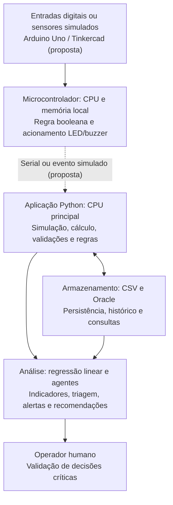

# Arquitetura computacional do SIFSM Aurora Siger

## 1. Objetivo e escopo

A arquitetura computacional do Sistema Integrado de Futuro Sustentável em Marte (SIFSM) deve sustentar a coleta de estados operacionais, a simulação energética, o armazenamento dos resultados e a análise assistida por IA. Seu propósito é manter decisões críticas simples e previsíveis, preservar a rastreabilidade e evitar consumo computacional desnecessário.

**Situação atual:** o protótipo implementa a interface em Python, a simulação de 168 horas com NumPy/pandas, a regressão linear, agentes especializados baseados em classificação TF-IDF e regras, além de dados em CSV e persistência em Oracle. **A regra booleana está implementada em Python e no sketch C++ para Arduino. A montagem no Tinkercad e a comunicação serial Arduino–Python ainda não foram validadas**.

## 2. Arquitetura em camadas



### Camada física e de controle

No sketch C++ incluído em `circuito/sifsm_alerta_energetico.ino`, o Arduino Uno recebe três entradas digitais por botões que representam consumo alto (A), módulo crítico (B) e falha (C). A lógica é:

```text
Alerta = (A AND B) OR C
```

Quando verdadeira, a CPU do microcontrolador ativa o LED e o buzzer. A decisão de alerta é local, sem depender de Oracle, rede ou IA. Isso favorece reação rápida e maior resiliência em caso de falha de comunicação. O comportamento lógico pode ser testado na opção 6 do menu Python. A montagem eletrônica no Tinkercad e a integração serial precisam de validação separada.

### Camada de processamento

O computador executa Python para gerar 168 registros horários de geração, consumo e estado de carga da bateria. NumPy realiza operações matemáticas; pandas organiza, agrega e exporta os dados. A regressão linear é ajustada em dados de treino e avaliada em dados de teste temporal.

### Camada de dados

O CSV permite analisar a simulação local. O Oracle armazena simulações, intervalos horários, regressões e recomendações; o usuário aciona explicitamente a gravação na opção de simulação correspondente. O banco também é consultado pelos agentes. Não se deve afirmar que qualquer evento do Arduino já é transmitido automaticamente ao Oracle.

### Camada analítica e supervisão

Agentes especializados analisam indicadores de energia, ambiente e dados com consultas predeterminadas, recuperação textual de exemplos e guardrails. As respostas são recomendações orientativas e não comandos de controle físico. Um operador humano valida ações sensíveis.

## 3. CPU, GPU, NPU, TPU e outros aceleradores

| Unidade | Papel técnico | Escolha no SIFSM |
|---|---|---|
| CPU (computador) | Execução sequencial e geral, interface Python, lógica, acesso a arquivos e Oracle | **Utilizada** no protótipo |
| CPU do microcontrolador | Leitura de entradas digitais e execução de lógica booleana com baixa latência | **Sketch C++ disponível; montagem ainda não validada** |
| GPU | Paralelismo massivo para grandes matrizes, gráficos complexos ou aprendizado profundo | **Não necessária** para 168 intervalos e regressão simples |
| NPU / TPU | Aceleração de inferência de redes neurais em hardware especializado | **Não necessárias** para o triador TF-IDF e regressão logística |
| ASIC | Circuito dedicado a tarefa fixa, eficiente para aplicações especializadas | **Referência conceitual**, não utilizado |

Não se deve afirmar que o projeto usa GPU, NPU, TPU ou ASIC se esses dispositivos não fazem parte da execução real.

## 4. Paralelismo e computação heterogênea

O cenário atual é pequeno: sete dias com 24 intervalos por dia (168 linhas). Para esse volume, uma CPU comum com operações vetorizadas do NumPy é suficiente e mais simples de manter do que introduzir processamento paralelo ou GPU. A divisão heterogênea proposta é funcional: microcontrolador para decisões locais de baixo custo e computador para cálculos e interação, enquanto o banco cuida de armazenamento e consultas.

Se o sistema crescesse para milhares de módulos e leituras por segundo, poderiam ser estudados: processamento de lotes, filas de eventos, paralelismo em análises independentes e avaliação do custo de transferência de dados para aceleradores. Qualquer ganho dependeria de medições; não há benchmark que comprove vantagem de GPU neste protótipo.

## 5. Hierarquia de memória, largura de banda e movimentação de dados

O Arduino teria memória limitada, armazenando apenas leituras e estado essenciais ao controle. O computador utiliza registradores e caches da CPU, memória RAM para arrays e DataFrames, e armazenamento persistente em CSV e Oracle.

Fluxo típico: dados de entrada -> RAM -> operações de CPU -> agregações -> CSV/Oracle -> consultas -> resposta apresentada. Evitar repetir leitura de CSV, consultas Oracle ou cópias completas de DataFrames reduz movimentação de dados. A largura de banda pode se tornar gargalo quando são transferidos muitos registros ou imagens, mas **não há medição de gargalo de memória ou rede documentada para este protótipo**.

## 6. Energia, desempenho e sustentabilidade

A escolha da menor capacidade computacional suficiente evita desperdício: regras booleanas simples podem rodar no microcontrolador; o computador processa os 168 intervalos; análises mais pesadas só seriam justificadas quando o volume de dados aumentasse. Os alertas locais continuam operacionais independentemente do banco, enquanto a análise centralizada permite explicar tendências e revisar ações.

Cuidados propostos:
- Consultar somente as colunas necessárias e processar registros em lotes adequados.
- Evitar transferir séries completas para a IA quando bastam indicadores agregados.
- Não manter serviços ou aceleradores ligados sem necessidade.
- Proteger credenciais Oracle e limitar acesso aos dados.
- Registrar falhas, preservar histórico e exigir validação humana de decisões críticas.

Essas são decisões e recomendações de arquitetura; o projeto **não mede consumo elétrico real de CPU, rede ou data center**, portanto não deve apresentar economia energética quantificada sem experimento.

## 7. Limites, riscos e evolução

1. Os sensores e o Arduino são simulados/propostos e não equivalem a medições ambientais reais em Marte.
2. A comunicação serial Arduino-Python, se adotada, precisa de protocolo simples (por exemplo, evento e timestamp), validação de mensagens e tratamento de desconexão.
3. A perda de rede deve afetar somente histórico/consultas, não o alerta local.
4. A regressão linear por hora não modela sozinha o ciclo diário completo; indicadores de teste precisam ser interpretados com cautela.
5. Para verificar desempenho, seria possível comparar tempo de execução, uso de RAM e número de leituras/escritas por simulação em hardware definido.
6. A arquitetura proposta ainda não foi avaliada em termos de latência, consumo de energia ou confiabilidade em operação real.

## 8. Resposta curta para a apresentação

> A arquitetura do SIFSM separa controle, processamento, dados e análise. O Arduino representa o controle local, cuja CPU pode acionar alertas sem depender da rede; o computador usa CPU para executar a simulação energética em Python, regressão e agentes; o Oracle e o CSV guardam os resultados. GPU, NPU e TPU não são necessários para apenas 168 registros. Essa distribuição simplifica o sistema, reduz processamento desnecessário e preserva a supervisão humana. A integração Arduino-Python é proposta e pode ser demonstrada separadamente no Tinkercad.

## 9. Correspondência com o enunciado

Esta seção cobre a parte conceitual de arquitetura de computadores: CPU, GPU, NPU, TPU, paralelismo, heterogeneidade, memória, largura de banda, gargalos e sustentabilidade. O circuito digital e sua demonstração prática pertencem também ao requisito específico de lógica booleana e automação embarcada.


## 10. Implementação do alerta booleano no repositório

- `src/logic_circuit.py`: avalia `(A and B) or C`, mostra as oito linhas da tabela verdade e permite testar entradas simuladas no terminal.
- `circuito/sifsm_alerta_energetico.ino`: sketch Arduino Uno com botões em D2, D3 e D4 usando `INPUT_PULLUP`, LED em D8 (resistor de 220 Ω), buzzer em D9 e estados no Monitor Serial a 9600 baud.
- `tests/test_logic_circuit.py`: valida as oito combinações de entradas e comportamentos básicos do menu.
- No terminal, executar `python codigo_fonte.py` e escolher **6 → 1** para testar entradas, **6 → 2** para tabela verdade, **6 → 3** para explicação da arquitetura.

**Limitação explícita:** a simulação em Python não recebe dados do Arduino, não altera a simulação energética de 168 intervalos e não aciona equipamentos. Para afirmar que a montagem funciona no Tinkercad, ainda é necessário inserir os componentes e sketch no simulador e registrar a evidência ou o link do circuito.
