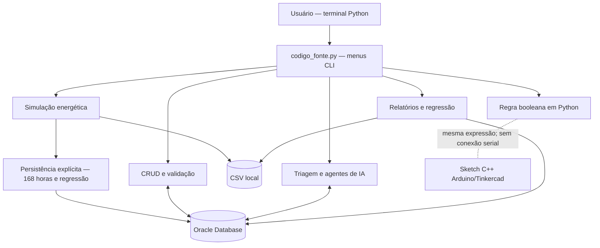

# RELATÓRIO TÉCNICO — SIFSM AURORA SIGER

**Sistema Integrado de Futuro Sustentável em Marte**  
**Curso:** Ciência da Computação — FIAP  
**Atividade:** Fase 7 / 2º semestre de 2026  
**Versão de referência:** código do repositório `SIFSM_Aurora_Siger`, consultado em 09/11/2026  
**Natureza:** protótipo acadêmico, com dados energéticos sintéticos

> **Nota de escopo.** O SIFSM é um protótipo demonstrativo. Dados, condições ambientais e falhas são simulados; não representam medições reais em Marte. Algumas integrações são conceituais. A montagem Arduino no Tinkercad e a comunicação direta Arduino–Python não foram comprovadas como executadas nesta versão. As recomendações da IA requerem supervisão humana.

---

## 1. Introdução

Uma colônia humana em Marte depende de sistemas confiáveis de geração, armazenamento e distribuição de energia. Oscilações na disponibilidade solar, aumentos de consumo e falhas em módulos críticos podem reduzir a autonomia e comprometer atividades essenciais. Antecipar esses riscos por simulação, documentar as decisões e organizar os dados operacionais é fundamental para um projeto sustentável.

O **Sistema Integrado de Futuro Sustentável em Marte (SIFSM) Aurora Siger** foi desenvolvido como uma aplicação de terminal em Python. O sistema reúne dados energéticos, simulação temporal, armazenamento em CSV e Oracle, operações CRUD, modelo linear simples, agentes de IA especializados e uma demonstração de lógica booleana equivalente à programada para Arduino.

**Objetivo geral:** apoiar a interpretação de cenários energéticos e a tomada de decisões orientativas para a colônia fictícia Aurora Siger, utilizando conteúdos integrados das disciplinas.

**Objetivos específicos:**
- Organizar e consultar registros simulados de operação, consumo e geração.
- Demonstrar persistência com banco Oracle, incluindo cadastro, leitura, atualização e exclusão.
- Simular 168 intervalos horários, registrando bateria, déficit, excedente e alertas.
- Implementar uma decisão booleana em Python e representá-la também em código C++ para Arduino.
- Aplicar estruturas de dados adequadas a consultas, sequências temporais e organização de eventos.
- Ajustar uma regressão linear, avaliar seu desempenho e explicitar seus limites.
- Demonstrar fluxo de IA com triagem, agentes especializados, consultas ao banco, recuperação textual e guardrails.
- Relacionar o processamento à arquitetura de computadores, à eficiência energética e à responsabilidade digital.

## 2. Escopo e arquitetura geral

O sistema é organizado em módulos com responsabilidades separadas. A interface principal é `codigo_fonte.py`, que apresenta seis áreas: gestão Oracle, simulação e análises, IA, relatórios, configurações e circuitos lógicos/arquitetura.



O CSV local e o Oracle não são uma única fonte sincronizada continuamente. **Na opção 2 → 1**, a simulação gera um CSV local; **na opção 2 → 4**, a execução efetua a gravação explícita de 168 intervalos e do resultado de regressão no Oracle e tenta atualizar o CSV. Os agentes consultam dados do Oracle, portanto a simulação considerada pela IA pode diferir da última execução local se ela não foi persistida.

A separação em módulos permite verificar isoladamente cálculos, interface, persistência e fluxos de IA. Os principais arquivos são:

| Arquivo | Finalidade |
|---|---|
| `codigo_fonte.py` | Menu principal e integração das funcionalidades |
| `src/simulation.py` | Simulação energética e geração de CSV |
| `src/regression.py` | Regressão linear e avaliação temporal |
| `src/persistence_pipeline.py` | Gravação transacional da simulação no Oracle |
| `src/database.py`, `src/repositories.py` | Conexões, operações SQL, validações e CRUD |
| `src/cli_data.py`, `src/terminal_views.py` | Interação e visualização organizada dos dados |
| `src/reports.py` | Resumos, alertas e exportação diária |
| `ia/ia_agentes.py` | Triador, agentes, ferramentas, handoffs, RAG textual e guardrails |
| `src/logic_circuit.py` | Teste interativo e tabela verdade da regra lógica |
| `circuito/sifsm_alerta_energetico.ino` | Código Arduino C++ equivalente |
| `banco_aurora_siger.sql` | Estrutura do banco |
| `docs/arquitetura_computacional.md` | Explicação técnica complementar da arquitetura |

## 3. Organização dos dados e banco Oracle

O banco relacional utiliza quatro tabelas principais, com identificadores, relacionamentos e restrições:

| Tabela | Dados armazenados |
|---|---|
| `SIMULACAO` | Identificador, nome, data inicial, semente, status e metadados |
| `INTERVALO_HORARIO` | 168 leituras por simulação, geração, consumo, saldo, temperatura e irradiância |
| `REGRESSAO_RESULTADO` | Variáveis, coeficientes, intercepto, R² registrado e número de observações |
| `RECOMENDACAO_IA` | Respostas e recomendações vinculadas às simulações, com tipo/modelo |

A implementação emprega `python-oracledb` e variáveis `ORACLE_USER`, `ORACLE_PASSWORD` e `ORACLE_DSN` obtidas da configuração do projeto. A senha não deve ser incluída em capturas, documentação pública ou no arquivo ZIP.

### 3.1 CRUD e validação

O menu **1 — Gestão de dados** permite listar, buscar por ID, cadastrar, atualizar e excluir registros das quatro categorias. As operações são implementadas em `src/repositories.py`; o módulo `src/cli_data.py` fornece a interface textual.

As validações incluem campos obrigatórios, limites de texto e de números, datas, estados permitidos e verificação de existência do registro. Comandos SQL utilizam parâmetros vinculados (por exemplo, `:id_registro`) em lugar de concatenar entradas de usuário diretamente no SQL.

A exclusão de uma simulação pode afetar registros vinculados por relacionamento em cascata; por isso, o menu exige confirmação explícita para excluir.

### 3.2 Controle de transações e erros

O módulo `src/database.py` centraliza a conexão com Oracle, exceções e transações. O fluxo adota `commit` quando todas as operações terminam com sucesso, `rollback` quando há falha e encerramento da conexão no bloco `finally`. Exceções como `ErroConexao`, `ErroIntegridade` e `RegistroNaoEncontrado` facilitam a identificação de problemas.

Na persistência dos 168 intervalos, `src/persistence_pipeline.py` valida os dados **antes** da primeira instrução SQL e grava a simulação, todos os intervalos e a regressão na **mesma transação**. Em caso de falha, o conjunto é desfeito, evitando persistência parcial.

**Cuidado para avaliação:** `banco_aurora_siger.sql` contém comandos de recriação das tabelas. O arquivo deve ser apresentado como script de estrutura, não executado indiscriminadamente em um banco já populado.

## 4. Circuitos lógicos, entradas digitais e Arduino

O sistema demonstra uma decisão de segurança operacional por meio de três variáveis booleanas:

- **A:** consumo alto identificado;
- **B:** módulo crítico;
- **C:** falha detectada.

A saída é:

```text
ALERTA = (A AND B) OR C
```

A decisão torna o alerta verdadeiro quando o consumo alto ocorre em um módulo crítico ou quando uma falha é registrada, independentemente das demais entradas.

### 4.1 Tabela verdade

| A | B | C | ALERTA |
|---:|---:|---:|---:|
| 0 | 0 | 0 | 0 |
| 0 | 0 | 1 | 1 |
| 0 | 1 | 0 | 0 |
| 0 | 1 | 1 | 1 |
| 1 | 0 | 0 | 0 |
| 1 | 0 | 1 | 1 |
| 1 | 1 | 0 | 1 |
| 1 | 1 | 1 | 1 |

São **oito combinações** e **cinco estados de alerta ativo**. Em `src/logic_circuit.py`, a função `avaliar_alerta` implementa a expressão, rejeita entradas não booleanas e o menu **6 → 1** permite testar as entradas. O menu **6 → 2** exibe a tabela verdade.

### 4.2 Equivalência com o Arduino

O sketch `circuito/sifsm_alerta_energetico.ino` utiliza um Arduino Uno com botões simulando A, B e C, ligados respectivamente aos pinos **D2, D3 e D4** com `INPUT_PULLUP`. O LED é previsto no **D8**, com resistor em série de **220 Ω**, e o buzzer no **D9**. Ao reconhecer alerta, o código aciona o LED, produz um tom e apresenta estados no Monitor Serial a **9600 baud**.

O código do Arduino e o Python executam **a mesma lógica de modo independente**. Não existe, nesta versão, transmissão serial integrada entre as duas aplicações, nem confirmação documental de montagem final testada no Tinkercad. A evidência visual ou um link do simulador deve ser acrescentado à entrega **somente após validação real**.

## 5. Estruturas de dados e justificativas

O programa utiliza estruturas coerentes com o volume e a finalidade dos dados:

| Estrutura | Exemplo no projeto | Justificativa |
|---|---|---|
| Lista Python | Sequência de registros horários e retornos de consultas | Mantém conjuntos ordenados e permite percorrer os dados |
| Dicionário Python | Cada intervalo, resultado estatístico, registro Oracle e contexto de sessão | Associa nomes de campos a valores, facilitando consultas e validação |
| DataFrame pandas | Tabela dos 168 intervalos | Permite filtragem, agregação por dia, leitura/escrita CSV e análise exploratória |
| Array NumPy | Cálculos numéricos da simulação e regressão | Facilita operações com séries e vetorização |
| Histórico de sessão | Lista de perguntas, respostas e rastros da IA | Apoia contexto e rastreabilidade durante a execução |
| Mapeamento de agentes | Dicionário que associa categorias aos agentes responsáveis | Facilita o roteamento de perguntas já classificadas |

A seleção dessas estruturas atende ao requisito de aplicação coerente: **o enunciado não exige implementar todas as estruturas estudadas**. Fila, pilha, árvore e grafo são possibilidades futuras para prioridades, histórico reversível ou conexões entre módulos, mas não são apresentados aqui como funcionalidades já implementadas.

## 6. Simulação computacional de energia

O módulo `src/simulation.py` simula **168 intervalos de uma hora**, totalizando **sete dias**. A cada passo são estimadas geração fotovoltaica, consumo, irradiância, temperatura, variação da bateria, perdas, excedente e déficit.

### 6.1 Hipóteses e variáveis

| Parâmetro | Valor de referência |
|---|---:|
| Duração | 168 horas (7 × 24) |
| Capacidade máxima da bateria | 300 kWh |
| Energia inicial da bateria | 240 kWh |
| Eficiência de carga e descarga | 95% |
| Semente pseudoaleatória | 42 |
| Consumo base | 12 kW |
| Acréscimo de consumo entre 08h e 20h | 4 kW |
| Dias com tempestade sintética | 4 e 5 |
| Critério de alerta | Bateria abaixo de 20% ou déficit positivo |

O consumo inclui pequenas variações pseudoaleatórias. A curva de geração depende da hora solar simulada e sofre redução durante os dias de tempestade. A semente fixa torna o cenário reproduzível.

### 6.2 Modelo matemático e integração temporal

Energia é a integral da potência no tempo:

```text
E = integral(P(t) dt)
```

Como a simulação trabalha com intervalos discretos de uma hora, utiliza a aproximação:

```text
E_intervalo (kWh) = P_média_intervalo (kW) × Δt (h),  com Δt = 1 h
```

O balanço bruto de cada intervalo é:

```text
saldo = geração − consumo
```

Se o saldo é positivo, a energia disponível carrega a bateria até seu limite, considerando perdas de eficiência. O excedente não armazenado é registrado separadamente. Se o saldo é negativo, a bateria descarrega até seu limite útil; o que não pode ser fornecido é registrado como déficit. O estado de carga (SOC) é:

```text
SOC (%) = 100 × energia_atual_bateria / capacidade_máxima
```

Assim, o cálculo relaciona **integração numérica discreta**, conservação de energia e controle do armazenamento. Os nomes `geracao_kw` e `consumo_kw` no CSV representam potências médias horárias que, por `Δt = 1 h`, são numericamente iguais à energia do respectivo intervalo em kWh. Essa equivalência não vale para intervalos de duração diferente.

### 6.3 Resultados de uma execução documentada

O arquivo `docs/ANALISE_Pessoa3.md` registra os seguintes resultados para a simulação reproduzível com semente 42:

| Indicador | Resultado |
|---|---:|
| Energia gerada | 2.640,308 kWh |
| Demanda total | 2.343,483 kWh |
| Perdas | 101,497 kWh |
| Excedente | 491,914 kWh |
| Demanda não atendida | 262,627 kWh |
| Energia restante da bateria | 206,040 kWh |
| Horas com alerta | 38 |

| Dia | Geração (kWh) | Demanda (kWh) | Déficit (kWh) | Bateria ao fim (kWh) |
|---:|---:|---:|---:|---:|
| 1 | 470,79 | 337,68 | 0,00 | 207,82 |
| 2 | 470,37 | 333,39 | 0,00 | 208,99 |
| 3 | 476,58 | 333,52 | 0,00 | 205,69 |
| 4 | 143,78 | 335,29 | 0,00 | 3,25 |
| 5 | 143,07 | 331,44 | 185,97 | 0,00 |
| 6 | 464,21 | 331,06 | 76,66 | 190,42 |
| 7 | 471,51 | 341,11 | 0,00 | 206,04 |

**Interpretação:** apesar de a geração semanal superar a demanda no total, há excedentes em certos períodos e déficits em outros. A bateria não consegue compensar toda a baixa geração nos dias críticos. Portanto, a soma semanal isolada não garante autonomia contínua; é necessário observar a distribuição temporal, o armazenamento e os períodos de escassez.

O programa gera o arquivo `dados_aurora_siger.csv` e relatórios por dia. A opção **2 → 2** permite visualizar resumos e páginas de registros, enquanto o menu **4** apresenta balanço, alertas e exportação.

## 7. Regressão linear e interpretação

O módulo `src/regression.py` ajusta uma regressão linear simples por mínimos quadrados para estimar **`consumo_kw`** em função de **`hora`**:

```text
ŷ = a × hora + b
```

Nessa expressão, `a` é o coeficiente angular, isto é, a variação média estimada do consumo para o avanço de uma hora, e `b` é o intercepto, ou valor previsto quando a hora é zero.

Os dados são ordenados pelo tempo e divididos em **80% para treinamento** e **20% para teste futuro**. Para 168 registros, são **134 horas de treino** e **34 de teste**. O sistema calcula:

- **MAE:** média dos erros absolutos da previsão no teste; menor é melhor.
- **RMSE:** raiz da média dos erros quadráticos; penaliza erros maiores.
- **R² de teste:** compara a capacidade explicativa do modelo com uma referência no conjunto de teste; pode ser negativo.
- **Baseline:** erro absoluto médio de uma previsão constante baseada na média do treino.

### 7.1 Exemplo numérico documentado

Conforme `docs/ANALISE_Pessoa3.md`:

```text
consumo_estimado = 0,00064711 × hora + 13,855302
Treinamento: 134 intervalos | Teste: 34 intervalos
MAE: 1,8829 kW | RMSE: 1,9730 kW | R² de teste: −0,0096
MAE do baseline: 1,8861 kW
Previsão didática para hora 168: 13,9640 kW
```

O coeficiente angular é muito pequeno, indicando pouca tendência linear de crescimento ao longo da semana. O **R² negativo** significa que o ajuste linear apresenta desempenho fraco no período de teste; o ganho de MAE sobre a referência de média é mínimo. Logo, **não seria correto declarar que esse modelo oferece previsões operacionais confiáveis**.

O consumo da simulação possui padrão diário e flutuações que não são representados adequadamente por apenas uma reta temporal. A tempestade interfere diretamente na geração solar simulada, não na função de consumo. Como melhoria, seriam necessárias características ligadas à hora do dia, demanda do módulo e condições operacionais; sua inclusão exigiria novos testes.

**Diferença entre métricas gravadas:** quando a execução persiste o modelo no Oracle, o campo `r_quadrado` guarda o **R² do treinamento**, enquanto o **R² do teste temporal** é apresentado no relatório local. Essas duas métricas não devem ser confundidas.

## 8. Sistemas multiagentes, ferramentas e segurança da IA

O módulo `ia/ia_agentes.py` implementa uma arquitetura didática orientada a tarefas. Sua função principal não é controlar o ambiente, mas **interpretar perguntas e gerar respostas orientativas fundamentadas nos dados disponíveis**.

### 8.1 Componentes do fluxo

1. **Guardrail de entrada:** bloqueia pedidos associados a ações inseguras ou a dados individuais sensíveis.
2. **Triador:** classifica a pergunta em `energia`, `ambiental`, `dados` ou `fora_do_escopo`, usando TF-IDF e regressão logística, com limiar configurado de 60%.
3. **Agentes especializados:** energia (geração, consumo e saldo), ambiental (irradiância e temperatura) e dados (histórico da simulação e regressão).
4. **Ferramentas determinísticas:** consultas SQL predefinidas ao Oracle, evitando a construção livre de SQL a partir da pergunta.
5. **Handoff:** transferência lógica entre especialistas, por exemplo, do agente de energia para o ambiental quando um déficit coincide com irradiância baixa.
6. **Recuperação textual:** busca por similaridade entre a pergunta e uma pequena base de documentos internos de exemplo, descrita no projeto como RAG simulado.
7. **Guardrail de saída:** reforça que a aplicação apenas sugere ações e exige revisão humana.
8. **Sessão e tracing:** histórico de interação e etapas de processamento durante a execução; respostas podem ser gravadas na tabela `RECOMENDACAO_IA`.
9. **Webhook didático:** fluxo simulado de evento e encaminhamento, sem integração operacional externa.

### 8.2 Papel e limitações

A IA do SIFSM não é um modelo generativo avançado nem uma solução autônoma de controle industrial. O classificador usa exemplos limitados de frases, podendo errar ao generalizar perguntas. A recuperação textual utiliza documentos de demonstração e não uma base científica ou operacional validada. Os agentes dependem dos dados existentes no Oracle e de sua disponibilidade.

Solicitações críticas não devem resultar em ações automáticas sobre equipamentos. Resultados e recomendações são submetidos à **avaliação de um operador humano**. A proteção de privacidade exige restringir credenciais, dados pessoais e registros sensíveis.

## 9. Arquiteturas modernas, memória e aceleração computacional

O SIFSM separa o raciocínio de **controle local** do **processamento analítico** e do **armazenamento**. A CPU de um computador executa Python, NumPy, pandas, interface textual e consultas. No circuito proposto, a CPU do Arduino executa entradas digitais e a expressão booleana, que pode permanecer ativa sem comunicação com o banco.

| Recurso | Análise aplicada ao projeto |
|---|---|
| **CPU** | Recurso principal usado no protótipo para operações gerais e cálculos |
| **Microcontrolador** | Sketch disponível para decisões simples e sinalização de alerta local |
| **GPU** | Não necessária para apenas 168 intervalos e uma regressão simples |
| **NPU/TPU** | Não necessárias para o triador TF-IDF e a regressão logística usados nesta escala |
| **ASICs/chiplets** | Conceitos de aceleração e organização de hardware, tratados conceitualmente |
| **Paralelismo** | Poderia ajudar em grandes volumes, mas não há evidência de vantagem neste protótipo |
| **Memória** | Arrays e DataFrames residem em RAM; caches e registradores da CPU aceleram acesso; CSV/Oracle persistem os dados |
| **Largura de banda** | Evitar consultas e transferências excessivas reduz custos de movimentação de dados |

A **computação heterogênea proposta** distribui tarefas simples para o controlador local e tarefas de análise para o computador. Essa divisão não prova, por si só, economia energética mensurável: não foram registrados benchmarks de consumo, RAM ou transferência de rede.

Para aprofundamento, consultar `docs/arquitetura_computacional.md`.

## 10. Sustentabilidade, cidadania digital e impacto socioambiental

O projeto relaciona tecnologia e sustentabilidade em aspectos diretamente conectados ao funcionamento do protótipo:

### 10.1 Prevenção de desperdícios

O balanço de geração, consumo, perdas e excedente evidencia horários em que há energia sobrando e outros em que ocorre déficit. A simulação permite avaliar hipóteses de redução de carga e ampliação de geração ou armazenamento **antes** de mudanças reais na infraestrutura.

### 10.2 Autonomia, armazenamento e resiliência

Nos dias de tempestade, a produção solar diminui e a bateria se aproxima de zero, mostrando que resiliência depende de acompanhar **quando** a energia fica disponível, não somente os totais acumulados. O alerta local baseado em regra booleana ilustra uma camada de controle que pode funcionar mesmo quando serviços de dados estão indisponíveis.

### 10.3 Privacidade e transparência

Credenciais Oracle devem permanecer em configuração local protegida. Consultas precisam ser restritas ao necessário e a IA não deve divulgar dados individuais da tripulação. Respostas automatizadas devem ser identificadas como recomendações, com limites e rastros de processamento claros.

### 10.4 Impacto energético da computação e da IA

Armazenamento, transmissão, processamento e centros de dados também consomem energia. Para o tamanho atual da aplicação, CPU convencional e algoritmos simples são proporcionais à necessidade. Executar tarefas pesadas ou aceleradores especializados sem benefício demonstrável poderia aumentar complexidade e consumo.

### 10.5 Responsabilidade, inclusão e decisões humanas

Uma decisão baseada exclusivamente em previsão estatística fraca poderia comprometer operações críticas. O sistema enfatiza supervisão humana, documentação das limitações e comunicação inteligível de alertas. Em uma futura aplicação real, seriam necessários critérios de acessibilidade da interface, autorização de acesso e validação por responsáveis técnicos.

Esses pontos representam uma **análise de impacto proposta para o cenário da colônia**. Não equivalem a indicadores ambientais medidos no mundo real.

## 11. Testes, evidências e qualidade

A validação automatizada está organizada na pasta `tests/`, com testes de simulação, regressão, erros, interfaces e regras lógicas. Entre os comportamentos cobertos:

- Duração e sequência de 168 intervalos e reprodução com semente fixa.
- Conservação e limites do balanço energético e da bateria.
- Exportação e leitura do CSV sem alterar a série.
- Regressão com conjunto de dados conhecido e rejeição de entradas inválidas.
- Rejeição de operações inválidas e falhas de persistência simuladas.
- Oito combinações da tabela verdade e comportamento da interface de circuito.
- Visualização paginada de CSV, indicadores e leitura de relatórios.

Os fluxos de persistência Oracle também dispõem de testes que usam substitutos (*mocks*), sem provar por si só a execução contra o Oracle remoto. Em uso local, o operador relatou conexão Oracle funcionando, identificação das quatro tabelas e execução da simulação de 168 intervalos. Tais validações devem ser documentadas com captura/resultado do ambiente, quando disponíveis.

**Evidência complementar:** `docs/ANALISE_Pessoa3.md` apresenta os resultados numéricos da simulação e regressão. Os testes automatizados podem ser executados com:

```powershell
python -m pytest -q
```

O comando acima depende de `pytest` instalado no ambiente de testes. A suíte automatizada não substitui uma demonstração visual no VS Code nem comprova que o circuito foi executado no Tinkercad.

### 11.1 Exemplos de apresentação prática

| Menu | Procedimento | Evidência esperada |
|---|---|---|
| 1 | Listar, buscar, cadastrar e alterar um registro de teste | Retorno de IDs e campos no Oracle |
| 2 → 1 | Executar a simulação | CSV com 168 horas e resumo energético |
| 2 → 2 | Consultar resumo, dias e páginas | Série tabulada e balanço diário |
| 2 → 3 | Executar regressão | Equação, MAE, RMSE e R² |
| 2 → 4 | Persistir simulação com nome único | IDs Oracle e 168 intervalos armazenados |
| 3 | Consultar IA e demonstrar guardrail | Classificação, resposta e limites |
| 4 | Exibir resumo e alertas | Totais, ocorrências e CSV diário |
| 5 | Verificar configuração e conexão | Diagnóstico de ambiente e Oracle |
| 6 | Testar A, B e C e ver tabela verdade | Regra lógica e explicação de arquitetura |

Não é necessário executar comandos destrutivos ou recriar tabelas para produzir evidências. A demonstração pode ser gravada em vídeo de até cinco minutos, conforme o enunciado.

## 12. Limitações e propostas de evolução

- **Dados sintéticos:** clima, energia e consumo não foram aferidos em um habitat marciano.
- **Modelo linear restrito:** o ajuste por hora não representa adequadamente o perfil diário; seu R² temporal precisa ser interpretado.
- **Integração não contínua:** CSV e Oracle são atualizados por ações específicas, sem transmissão de sensores reais.
- **Arduino independente:** sketch e simulador Python compartilham a expressão, mas não possuem integração serial testada.
- **IA didática:** classificador de poucos exemplos e recuperação textual limitada; não é uma IA operacional autônoma.
- **Escalabilidade não medida:** sem benchmarks de latência, throughput ou consumo real do hardware.
- **Segurança de produção:** o protótipo exige, antes de qualquer implantação real, controle de acesso, políticas de retenção, observabilidade, backup e tratamento de falhas.

Evoluções possíveis incluem: comparação de cenários de dimensionamento da bateria, gráficos temporais, importação validada de sensores simulados via serial, organização de alertas em fila de prioridades, melhoria da regressão com atributos de hora do dia e experimentos quantitativos de desempenho e consumo computacional. Essas evoluções **não devem ser confundidas com funcionalidades já concluídas**.

## 13. Conclusão

O SIFSM Aurora Siger demonstra uma integração interdisciplinar de programação em Python, estruturas de dados, modelagem matemática, persistência Oracle, lógica digital e análise orientada por agentes. A simulação revela que geração suficiente no balanço semanal não impede períodos de déficit quando há baixa disponibilidade solar e armazenamento limitado.

O protótipo atende ao propósito acadêmico de **organizar, simular, consultar e interpretar dados para apoiar decisões sustentáveis**, sem prometer autonomia operacional. A arquitetura valoriza regras locais simples, análise de dados com resultados verificáveis e supervisão humana das recomendações.

Os próximos avanços devem priorizar validação do circuito no Tinkercad, reforço das evidências de execução, atualização da documentação de entrega e experimentos adicionais que quantifiquem desempenho e consumo.

## 14. Referências internas e arquivos de apoio

As descrições técnicas deste relatório baseiam-se nos seguintes artefatos do próprio projeto:

- `README.md` — objetivos, organização e modo de execução.
- `codigo_fonte.py` — menus e integração da aplicação.
- `src/simulation.py` e `dados_aurora_siger.csv` — dinâmica energética e dados sintéticos.
- `src/regression.py` — modelo linear e métricas.
- `src/database.py`, `src/repositories.py`, `src/persistence_pipeline.py` e `banco_aurora_siger.sql` — esquema, CRUD e transações.
- `src/logic_circuit.py` e `circuito/sifsm_alerta_energetico.ino` — regra booleana em Python e C++.
- `ia/ia_agentes.py` — triagem, ferramentas, agentes, proteção e contexto.
- `docs/arquitetura_computacional.md` — detalhamento da organização computacional.
- `docs/ANALISE_Pessoa3.md` — resultados numéricos documentados de 168 horas.
- `tests/` — testes automatizados do sistema.

---

**Nota para a entrega:** incluir este `relatorio_tecnico.md` no ZIP junto com os códigos, o SQL, CSV, README, material do circuito (ou link validado do Tinkercad, se efetivamente utilizado) e `link_video.txt` contendo o vídeo publicado como *Não listado*. Não incluir `.env`, senhas, `.venv` ou outros arquivos privados.
